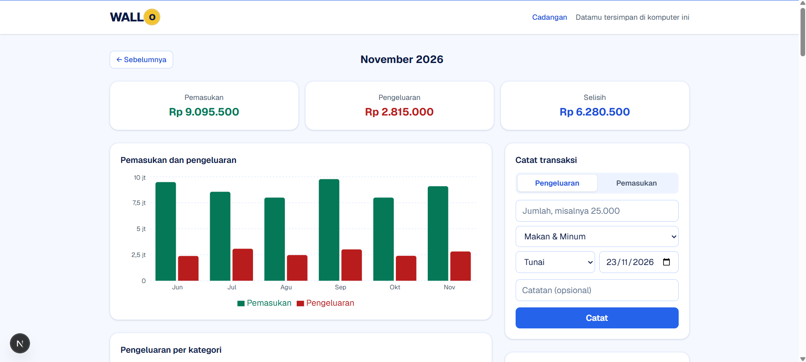
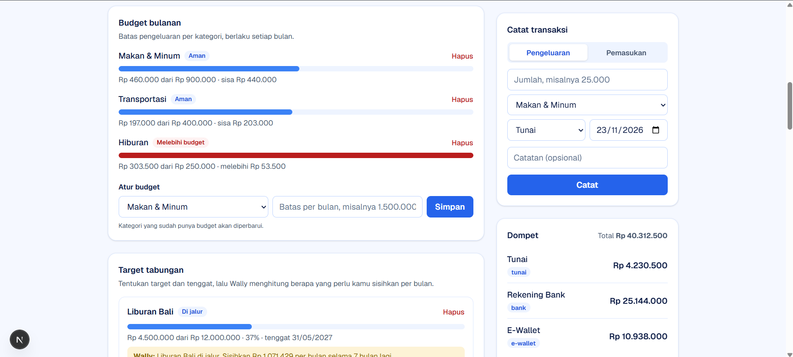
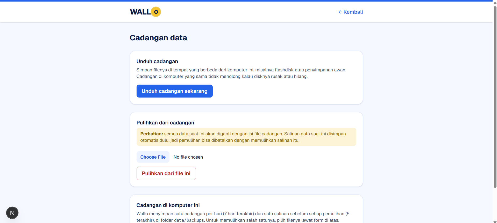

# Wallo

> Your money, on your machine.

A privacy-first personal finance tracker. Everything you record stays in a
single SQLite file on your own computer: no account, no cloud, no tracking.

Built as a portfolio project while moving from PHP/CodeIgniter to the
TypeScript/Next.js ecosystem. The interface is in Indonesian (Rupiah, Indonesian
month names), and the code and docs are in English.



## Features

- **Wallets and transactions**: cash, bank, and e-wallet accounts; income and
  expense entries with categories, notes, and dates; live wallet balances
- **Monthly overview**: income, expenses, and net for any month, with a
  6-month trend chart and a ranked spending breakdown by category
- **Budgets**: a monthly limit per expense category, with a progress bar and a
  status (safe, nearly used up at 80%, exceeded at 100%)
- **Savings goals**: set a target and a deadline, record deposits, and see how
  much to set aside each month and whether you are on track
- **Wally**: the in-app voice that warns you about budgets and encourages your
  goals. It is plain rule-based logic; there is no AI or external service
- **Backup and restore**: one-click download, validated restore, and automatic
  daily backups

| Budgets and goals                           | Backup                     |
| ------------------------------------------- | -------------------------- |
|  |  |

## Tech stack

- [Next.js](https://nextjs.org) 16 (App Router, Server Components, Server
  Actions), React 19, TypeScript
- Tailwind CSS v4
- SQLite through [`better-sqlite3`](https://github.com/WiseLibs/better-sqlite3)
- [Zod](https://zod.dev) for validation, [Recharts](https://recharts.org) for
  charts
- [Vitest](https://vitest.dev) for tests

## Getting started

Requires Node.js 20 or newer (developed on Node 26).

```bash
git clone https://github.com/allifalfiyan/wallo.git
cd wallo
npm install
npm run dev
```

Open [http://localhost:3000](http://localhost:3000). On first run, Wallo asks you to create your first
wallet. Your data is stored in `data/wallo.db`.

For a production build:

```bash
npm run build
npm start
```

| Script                            | What it does                                            |
| --------------------------------- | ------------------------------------------------------- |
| `npm run dev`                   | Start the development server                            |
| `npm run build` / `npm start` | Production build and server                             |
| `npm test`                      | Run the test suite                                      |
| `npm run db:cek`                | Print the schema version and row counts of the database |

**Configuration** (optional): set `WALLO_DB_PATH` to store the database
somewhere else. Automatic backups follow it into a `backups` folder next to the
database file.

### Try it with demo data

To explore Wallo with sample data without touching your own, use a separate
database. In PowerShell:

```powershell
$env:WALLO_DB_PATH = "data/demo/demo.db"
npm run dev        # open the app once, then stop the server
node scripts/seed-demo.js
npm run dev
```

On macOS or Linux, use `export WALLO_DB_PATH=data/demo/demo.db`. The seed script
refuses to run against any database whose file name does not contain "demo".

## Backup and restore

- **Download a backup** from the Backup page. Keep the file somewhere other than
  this computer (a USB drive or cloud storage).
- **Restore** from any backup file. Wallo checks the file first, saves a copy of
  your current data, and only then replaces it. If anything fails midway, your
  previous data is put back.
- **Automatic backups**: one per day (last 7 kept) in `data/backups`, plus a
  safety copy before every restore (last 5 kept). These protect against mistakes
  and data corruption, but not against a failed disk, so download a copy now and
  then.

## How it's built

```
app/            Pages, Server Actions, and the two route handlers
  api/backup      Download a backup
  api/pulihkan    Validate and restore a backup
  cadangan/       Backup page
  setup/          First-run wallet setup
lib/            Domain logic and its tests (no React, no Next.js)
scripts/        Database inspection and demo data
data/           The SQLite database and backups (git-ignored)
```

The domain logic in `lib/` takes the database as a parameter, so every rule can
be tested against an in-memory SQLite database.

### Design decisions

| Decision                                                           | Why                                                                                                                                                      |
| ------------------------------------------------------------------ | -------------------------------------------------------------------------------------------------------------------------------------------------------- |
| Money is stored as integer rupiah                                  | No floating-point rounding errors. `parseRupiah` rejects ambiguous input like `1.5` instead of guessing                                              |
| Dates are `YYYY-MM-DD` text in local time                        | They are calendar dates, not instants, so there are no timezone surprises, and they sort correctly as text                                               |
| Schema migrations tracked with `PRAGMA user_version`             | Existing data upgrades in place when the app is updated. Released migrations are never edited                                                            |
| SQLite in WAL mode                                                 | Writes survive crashes and power loss better                                                                                                             |
| Backups use SQLite's backup API                                    | A plain file copy can miss recent data that still sits in the WAL file                                                                                   |
| Restore: validate, save a safety copy, swap, roll back on failure  | A bad or corrupt file can never destroy existing data. Backups from older versions are migrated automatically, and ones from newer versions are rejected |
| Budget and goal math uses integers only                            | Status thresholds are exact. Monthly savings round up so a goal is never missed by rounding, and percentages round down so 99.9% never shows as 100%     |
| Validation on the server (Zod) plus database `CHECK` constraints | The browser is never trusted, and the database is the second line of defense                                                                             |
| Forms keep their input after a validation error                    | React 19 resets a form after an action, which would otherwise wipe what the user typed                                                                   |
| The restore endpoint checks the `Origin` header                  | Stops other websites open in your browser from silently posting to `localhost`                                                                         |

### Testing

```bash
npm test
```

More than 70 unit and integration tests cover money parsing and formatting,
validation, transactions, reports, budgets, savings goals, and the backup and
restore cycle. Where an exact boundary matters (the 80% budget threshold, the
last day of a 31-day month, a UTC date that differs from the local date), the
test sits exactly on it.

## Security and privacy

- No analytics, no third-party requests. Fonts are bundled with the app.
- All queries use prepared statements.
- **There is no login yet.** Wallo is meant for your own computer. If you host
  it on a server, put it behind authentication and HTTPS, because anyone who
  can reach the app can read and download your data.

## Limitations and roadmap

- [ ] Access PIN or password
- [ ] Edit transactions (today you delete and re-enter)
- [ ] Manage wallets and categories
- [ ] CSV export and import
- [ ] Recurring transactions
- [ ] `docker compose up`, and a desktop installer for non-technical users

## License

[MIT](LICENSE)

Built by [Alli](https://github.com/allifalfiyan)

This is a [Next.js](https://nextjs.org) project bootstrapped with [`create-next-app`](https://nextjs.org/docs/app/api-reference/cli/create-next-app).

## Getting Started

First, run the development server:

```bash
npm run dev
# or
yarn dev
# or
pnpm dev
# or
bun dev
```

Open [http://localhost:3000](http://localhost:3000) with your browser to see the result.

You can start editing the page by modifying `app/page.tsx`. The page auto-updates as you edit the file.

This project uses [`next/font`](https://nextjs.org/docs/app/building-your-application/optimizing/fonts) to automatically optimize and load [Geist](https://vercel.com/font), a new font family for Vercel.

## Learn More

To learn more about Next.js, take a look at the following resources:

- [Next.js Documentation](https://nextjs.org/docs) - learn about Next.js features and API.
- [Learn Next.js](https://nextjs.org/learn) - an interactive Next.js tutorial.

You can check out [the Next.js GitHub repository](https://github.com/vercel/next.js) - your feedback and contributions are welcome!

## Deploy on Vercel

The easiest way to deploy your Next.js app is to use the [Vercel Platform](https://vercel.com/new?utm_medium=default-template&filter=next.js&utm_source=create-next-app&utm_campaign=create-next-app-readme) from the creators of Next.js.

Check out our [Next.js deployment documentation](https://nextjs.org/docs/app/building-your-application/deploying) for more details.
